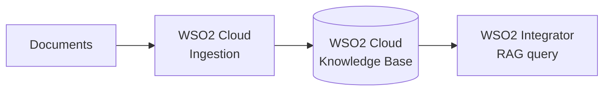

import ThemedImage from '@theme/ThemedImage';
import useBaseUrl from '@docusaurus/useBaseUrl';

# RAG Ingestion

For the recommended RAG workflow, create and populate a knowledge base in WSO2 Cloud. WSO2 Cloud manages document ingestion and indexing, while your WSO2 Integrator project connects to the resulting knowledge base to retrieve content at runtime.

This separation keeps ingestion out of the query integration and lets you update the indexed content in WSO2 Cloud without rebuilding or redeploying the integration.

:::info Prerequisites

- Access to a WSO2 Cloud organization and project.
- Documents that you want to use to ground the RAG responses.
- WSO2 Integrator signed in to the same WSO2 Cloud organization, with the correct project selected.

:::

## Step 1: Create and populate the knowledge base in WSO2 Cloud

Follow [Ingest documents into a knowledge base in WSO2 Cloud](product://saas/manage/cloud/rag-ingestion/ingestion) to:

1. Create a knowledge base in your WSO2 Cloud project.
2. Add the documents or data source that you want the knowledge base to index.
3. Start ingestion and wait until the content is ready to query.

Keep the knowledge base in the same WSO2 Cloud project that you select in WSO2 Integrator. The editor uses that project context to discover the available knowledge bases and supply their connection details securely.

:::note
Document ingestion is performed in WSO2 Cloud. You do not need to build a separate automation with a data loader, embedding provider, vector store, or `Ingest` action for this workflow.
:::

## Step 2: Connect the knowledge base in WSO2 Integrator

After the Cloud ingestion finishes, add the existing knowledge base to the integration project:

1. In the flow editor, select **+** to open the **Add Node** panel.
2. Go to **AI > RAG > Knowledge Base**, and select **Add Knowledge Base**.
3. Select **WSO2 Cloud Knowledge Base**.
4. Under **Existing WSO2 Cloud Knowledge Bases**, select the knowledge base that you populated in Step 1.

    <ThemedImage
        alt="WSO2 Cloud Knowledge Bases picker listing the knowledge bases available in the selected WSO2 Cloud project."
        sources={{
            light: useBaseUrl('/img/genai/develop/components-v5.1/knowledge-bases/07-wso2-cloud-list-v5.1.png'),
            dark: useBaseUrl('/img/genai/develop/components-v5.1/knowledge-bases/07-wso2-cloud-list-v5.1.png'),
        }}
    />

5. Review the prefilled **Service URL** and **Knowledge Base Authentication Configuration**. WSO2 Cloud supplies these values from the selected knowledge base, so you do not need to copy credentials into the project.

    <ThemedImage
        alt="Create WSO2 Cloud Knowledge Base form with the service URL and authentication configuration filled from the selected cloud knowledge base."
        sources={{
            light: useBaseUrl('/img/genai/develop/components-v5.1/knowledge-bases/08-wso2-cloud-prefilled-form-v5.1.png'),
            dark: useBaseUrl('/img/genai/develop/components-v5.1/knowledge-bases/08-wso2-cloud-prefilled-form-v5.1.png'),
        }}
    />

6. Optionally adjust retrieval settings such as **Minimum Similarity Threshold** and the reranker configuration, then select **Save**.

The integration project now has a connection to the populated WSO2 Cloud Knowledge Base. Do not add an `Ingest` action to the integration flow; manage future document additions and re-ingestion from WSO2 Cloud.

## Step 3: Build the query flow

Continue to [RAG query](rag-query.md) to retrieve relevant chunks from the WSO2 Cloud Knowledge Base, augment the user's question, and generate a grounded response.

## Keep the knowledge base up to date

When source content changes, update or re-ingest it from WSO2 Cloud. The query integration continues to use the same knowledge base connection and does not need to change unless you replace the knowledge base itself.

## What's next

- **[RAG query](rag-query.md)** — retrieve indexed content and generate grounded responses.
- **[Knowledge Bases](../ai-building-blocks/knowledge-bases.md#wso2-cloud-knowledge-base)** — configure the WSO2 Cloud Knowledge Base connection and retrieval settings.
