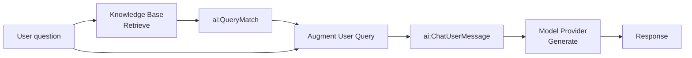

import ThemedImage from '@theme/ThemedImage';
import useBaseUrl from '@docusaurus/useBaseUrl';

# RAG Query

The query integration runs on every user request. It retrieves relevant chunks from a WSO2 Cloud Knowledge Base populated in WSO2 Cloud, combines them with the user's question, and calls the LLM to produce a grounded response.

This page covers building the query integration in WSO2 Integrator: wiring up retrieve, augment, and generate nodes, and testing the endpoint.

:::info
Complete [RAG ingestion](rag-ingestion.md) before starting this page. Create the knowledge base and ingest its documents in WSO2 Cloud, then connect that same knowledge base to this integration.
:::

---

## What the RAG query does



The four nodes, **Retrieve**, **Augment User Query**, **Generate**, and **Return**, map directly to Steps 2-6 below.

---

:::info Prerequisites

- A WSO2 Cloud Knowledge Base has been created and populated by following [RAG ingestion](rag-ingestion.md).
- WSO2 Integrator is signed in to the same WSO2 Cloud organization, with the project containing the knowledge base selected.
- A configured model provider. The default WSO2 provider works out of the box. Run `Ballerina: Configure default WSO2 model provider` if you haven't already.
- An **HTTP service** with a `POST /query` resource and a `userQuery` string payload parameter. See Step 1 below.

:::

---

## Step 1: Create an HTTP service

1. On the **Design** tab, select **Add Artifact manually** (below the WSO2 Integrator Copilot's quick-start cards). If the project already has other artifacts, this same button appears directly as **+ Add Artifact** instead.

    <ThemedImage
        alt="Artifacts page listing artifact types including HTTP Service under Integration as API."
        sources={{
            light: useBaseUrl('/img/genai/develop/rag-v5.1/rag-query/01-add-artifact-v5.1.png'),
            dark: useBaseUrl('/img/genai/develop/rag-v5.1/rag-query/01-add-artifact-v5.1.png'),
        }}
    />

2. Under **Integration as API**, select **HTTP Service**. On the **Create HTTP Service** form, leave **Design From Scratch** selected, leave **Service Base Path** as `/`, and select **Create**.

    <ThemedImage
        alt="Create HTTP Service form with Service Contract set to Design From Scratch and Service Base Path set to /."
        sources={{
            light: useBaseUrl('/img/genai/develop/rag-v5.1/rag-query/02-http-service-form-create-v5.1.png'),
            dark: useBaseUrl('/img/genai/develop/rag-v5.1/rag-query/02-http-service-form-create-v5.1.png'),
        }}
    />

3. In the HTTP Service editor, select **+ Add Resource**. A method selection panel opens on the right.

    <ThemedImage
        alt="HTTP Service editor showing no resources and the Select HTTP Method to Add panel."
        sources={{
            light: useBaseUrl('/img/genai/develop/rag-v5.1/rag-query/03-http-service-add-resource-v5.1.png'),
            dark: useBaseUrl('/img/genai/develop/rag-v5.1/rag-query/03-http-service-add-resource-v5.1.png'),
        }}
    />

4. Select **POST** from the method list.

    <ThemedImage
        alt="Select HTTP Method to Add panel listing GET, POST, PUT, DELETE, PATCH, and DEFAULT."
        sources={{
            light: useBaseUrl('/img/genai/develop/rag-v5.1/rag-query/04-select-post-v5.1.png'),
            dark: useBaseUrl('/img/genai/develop/rag-v5.1/rag-query/04-select-post-v5.1.png'),
        }}
    />

5. In the **New Resource Configuration** panel, set **Resource Path** to `query`. Select **+ Define Payload**, switch to the **Create Type Schema** tab, name the type `QueryPayload`, and add a field named `userQuery` of type `string`. Select **Save**.

    <ThemedImage
        alt="New Resource Configuration panel with POST method, query resource path, QueryPayload payload, and the default 201 json / 500 error responses."
        sources={{
            light: useBaseUrl('/img/genai/develop/rag-v5.1/rag-query/05-resource-config-query-v5.1.png'),
            dark: useBaseUrl('/img/genai/develop/rag-v5.1/rag-query/05-resource-config-query-v5.1.png'),
        }}
    />

---

## Step 2: Connect and retrieve from the knowledge base

Connect the existing WSO2 Cloud Knowledge Base to the integration, then use its **Retrieve** action to find chunks most similar to the user's question.

1. In the flow editor, select **+** to open the **Add Node** panel.
2. Go to **AI > RAG** and select **Knowledge Base**.

    :::info
    If the knowledge base has not been created and populated yet, follow [RAG ingestion](rag-ingestion.md) first. Ingestion takes place in WSO2 Cloud, not in this query flow.
    :::

    <ThemedImage
        alt="Add Node panel with AI > RAG > Knowledge Base highlighted, tooltip Knowledge bases available in the integration."
        sources={{
            light: useBaseUrl('/img/genai/develop/rag-v5.1/rag-query/06-knowledgebase-select-v5.1.png'),
            dark: useBaseUrl('/img/genai/develop/rag-v5.1/rag-query/06-knowledgebase-select-v5.1.png'),
        }}
    />

3. If the knowledge base is not already connected to this integration project, select **Add Knowledge Base**, and then select **WSO2 Cloud Knowledge Base**.
4. Under **Existing WSO2 Cloud Knowledge Bases**, select the knowledge base that you populated during ingestion.

    <ThemedImage
        alt="WSO2 Cloud Knowledge Bases picker listing the knowledge bases available in the selected WSO2 Cloud project."
        sources={{
            light: useBaseUrl('/img/genai/develop/components-v5.1/knowledge-bases/07-wso2-cloud-list-v5.1.png'),
            dark: useBaseUrl('/img/genai/develop/components-v5.1/knowledge-bases/07-wso2-cloud-list-v5.1.png'),
        }}
    />

5. Review the prefilled service URL and authentication configuration, optionally adjust the retrieval settings, and select **Save**.

    <ThemedImage
        alt="Create WSO2 Cloud Knowledge Base form with the service URL and authentication configuration filled from the selected cloud knowledge base."
        sources={{
            light: useBaseUrl('/img/genai/develop/components-v5.1/knowledge-bases/08-wso2-cloud-prefilled-form-v5.1.png'),
            dark: useBaseUrl('/img/genai/develop/components-v5.1/knowledge-bases/08-wso2-cloud-prefilled-form-v5.1.png'),
        }}
    />

6. Expand the new WSO2 Cloud Knowledge Base connection in the **Knowledge Bases** panel and select **Retrieve**, *"Retrieves relevant chunk for the given query."*
7. Configure the node:

    | Field | Required | Value |
    | --- | --- | --- |
    | **Query** | Yes | Bind to the incoming user question, for example `payload.userQuery` (Expression mode). |
    | **Top K** | No | Number of chunks to return. Default is `10`. Increase if relevant content is being missed; use `-1` to return all. |
    | **Filters** | No | Metadata filters to restrict results. Useful for multi-tenant scenarios where users should only see their own documents. |
    | **Result** | Yes | For example, `context`. **Result Type** is locked to `ai:QueryMatch[]`. |

8. Select **Save**.

    <ThemedImage
        alt="ai:retrieve form with Query set to payload.userQuery, Top K default 10, Filters empty, and Result set to context."
        sources={{
            light: useBaseUrl('/img/genai/develop/rag-v5.1/rag-query/08-retrieve-form-v5.1.png'),
            dark: useBaseUrl('/img/genai/develop/rag-v5.1/rag-query/08-retrieve-form-v5.1.png'),
        }}
    />

The result is an array of `ai:QueryMatch` values. Each entry contains a chunk and its similarity score against the query.

:::info
The WSO2 Cloud Knowledge Base handles embedding and retrieval. The query integration does not need a separate vector store or embedding provider; it only needs to connect to the same cloud knowledge base that contains the ingested documents.
:::

<ThemedImage
    alt="Flow editor showing the ai:retrieve node (context) added after the HTTP service resource."
    sources={{
        light: useBaseUrl('/img/genai/develop/rag-v5.1/rag-query/09-retrieve-node-v5.1.png'),
        dark: useBaseUrl('/img/genai/develop/rag-v5.1/rag-query/09-retrieve-node-v5.1.png'),
    }}
/>

---

## Step 3: Augment the user query

The **Augment User Query** node combines the retrieved chunks with the original question into a single formatted `ai:ChatUserMessage` ready for the LLM.

1. Select **+** after the Retrieve node.
2. Go to **AI > RAG > Augment Query**.
3. Configure the node:

    | Field | Required | Value |
    | --- | --- | --- |
    | **Context** | Yes | Switch to **Expression** mode and set it to the retrieval results, for example `context`. |
    | **Query** | Yes | The original user question, for example `payload.userQuery`. |
    | **Result** | Yes | Auto-fills a generated name, for example `aiChatusermessage`. **Result Type** is locked to `ai:ChatUserMessage`. |

4. Select **Save**.

    <ThemedImage
        alt="ai:augmentUserQuery form with Context set to context (Expression mode), Query set to payload.userQuery, and Result set to aiChatusermessage."
        sources={{
            light: useBaseUrl('/img/genai/develop/rag-v5.1/rag-query/10-augment-form-v5.1.png'),
            dark: useBaseUrl('/img/genai/develop/rag-v5.1/rag-query/10-augment-form-v5.1.png'),
        }}
    />

This step handles prompt construction automatically. You do not need to manually interleave chunks and questions.

<ThemedImage
    alt="Flow editor showing the ai:augmentUserQuery node added after the ai:retrieve node."
    sources={{
        light: useBaseUrl('/img/genai/develop/rag-v5.1/rag-query/11-augment-node-v5.1.png'),
        dark: useBaseUrl('/img/genai/develop/rag-v5.1/rag-query/11-augment-node-v5.1.png'),
    }}
/>

---

## Step 4: Add a model provider

1. Select **+** after the Augment Query node.
2. Go to **AI > Direct LLM > Model Provider**.
3. Select an existing model provider connection, or select **+ Add Model Provider** to create one, for example **Default Model Provider (WSO2)** named `aiWso2modelprovider`.
4. Expand the connection to reveal its **Chat** and **Generate** actions.

    <ThemedImage
        alt="Model Providers panel with aiWso2modelprovider expanded, showing Chat and Generate actions, with the Generate tooltip visible."
        sources={{
            light: useBaseUrl('/img/genai/develop/rag-v5.1/rag-query/12-model-provider-node-v5.1.png'),
            dark: useBaseUrl('/img/genai/develop/rag-v5.1/rag-query/12-model-provider-node-v5.1.png'),
        }}
    />

---

## Step 5: Generate the response

The **Generate** action calls the LLM with the augmented message and returns the model's answer. Select **Generate**, not **Chat**: Generate is the single-shot completion action that fits this flow, while Chat is for multi-turn conversations.

1. Configure the node:

    | Field | Required | Value |
    | --- | --- | --- |
    | **Prompt** | Yes | Switch to **Expression** mode and set it to the augmented message content, for example `check aiChatusermessage.content.ensureType()`. |
    | **Expected Type** | Yes | Set to `string` for plain-text responses. Use a record type to get a structured response. |
    | **Result** | Yes | For example, `response`. |

2. Select **Save**.

    <ThemedImage
        alt="ai:generate form with Prompt set to check aiChatusermessage.content.ensureType(), Expected Type string, and Result set to response."
        sources={{
            light: useBaseUrl('/img/genai/develop/rag-v5.1/rag-query/13-generate-form-v5.1.png'),
            dark: useBaseUrl('/img/genai/develop/rag-v5.1/rag-query/13-generate-form-v5.1.png'),
        }}
    />

    <ThemedImage
        alt="Flow editor showing the ai:generate node (response) added, connected to the aiWso2modelprovider connection."
        sources={{
            light: useBaseUrl('/img/genai/develop/rag-v5.1/rag-query/14-final-flow-v5.1.png'),
            dark: useBaseUrl('/img/genai/develop/rag-v5.1/rag-query/14-final-flow-v5.1.png'),
        }}
    />

---

## Step 6: Return the response

1. Select **+** after the Generate node.
2. Select **Return**.
3. Set the expression to `response`.
4. Select **Save**.

<ThemedImage
    alt="Complete RAG query integration: Start, ai:retrieve, ai:augmentUserQuery, ai:generate, Return, and Error Handler."
    sources={{
        light: useBaseUrl('/img/genai/develop/rag-v5.1/rag-query/15-rag-query-pipeline-v5.1.png'),
        dark: useBaseUrl('/img/genai/develop/rag-v5.1/rag-query/15-rag-query-pipeline-v5.1.png'),
    }}
/>

---

## Running and testing

Select **Run**. Once the integration starts, test the endpoint:

```bash
curl -X POST http://localhost:9090/query \
  -H "Content-Type: application/json" \
  -d '{"userQuery": "<your question>"}'
```

The response will be grounded in the documents you ingested.

---

## Use the knowledge base as an agent tool

Steps 2 to 6 build a fixed flow: every request calls **Retrieve** with the user's question, then augments and generates. You can instead give the WSO2 Cloud Knowledge Base to an AI agent as a tool. The agent decides when to search the knowledge base and what to search for, then answers using the chunks it gets back.

| | Fixed RAG flow (Steps 2 to 6) | Knowledge base as an agent tool |
| --- | --- | --- |
| **When Retrieve runs** | On every request. | Only when the agent decides it needs the knowledge base. |
| **Search query** | The user's question, unchanged. | Written by the agent, so it can rephrase, narrow, or search more than once. |
| **Best for** | Single-turn question answering over one knowledge base. | Conversations, and agents that combine the knowledge base with other tools. |

### Add the knowledge base tool

1. Open the agent and click the **+** button on the **AI Agent** node to open the **Add Tool** panel.
2. Select **Use Knowledge Base**.
3. Select **WSO2 Cloud Knowledge Base**, and then select the **Retrieve** action. The **Add Tool - Use Knowledge Base** panel opens.

    <ThemedImage
        alt="Add Tool - Use Knowledge Base panel for the WSO2 Cloud Knowledge Base retrieve action, with Tool Name retrieveTool, a prefilled description, and a Knowledge Base Instance field showing No knowledge bases in this project with a Create knowledge base button."
        sources={{
            light: useBaseUrl('/img/genai/develop/components-v5.1/knowledge-bases/07-wso2-cloud-create-v5.1.png'),
            dark: useBaseUrl('/img/genai/develop/components-v5.1/knowledge-bases/07-wso2-cloud-create-v5.1.png'),
        }}
    />

4. Configure the tool:

    | Field | Required | Value |
    | --- | --- | --- |
    | **Tool Name** | Yes | A unique name for the tool, for example `retrieveTool`. |
    | **Description** | No | What the tool does. The agent reads this to decide when to call the tool, so describe the content in the knowledge base, for example `Retrieves HR policy content for the given query.` |
    | **Knowledge Base Instance** | Yes | The WSO2 Cloud Knowledge Base connection from [Step 2](#step-2-connect-and-retrieve-from-the-knowledge-base). If the project has none yet, click **Create knowledge base** and select the knowledge base that you populated during [RAG ingestion](rag-ingestion.md). |
    | **Requires Approval** | No | Pauses the tool before it runs and waits for a person to approve the call. |

5. Select **Save**.

The **Retrieve** action is now available to the agent as a tool. When a user asks a question, the agent calls the tool with a query it writes, receives the matching chunks with their `similarityScore`, and uses them to ground its answer. You don't need separate **Augment User Query** or **Generate** nodes; the agent's own model provider handles both.

:::note
The agent only reads from the knowledge base. To add or update documents, ingest them in WSO2 Cloud as described in [RAG ingestion](rag-ingestion.md).
:::

For the other tool types and tool settings, see [Tools](../agents/tools.md).

---

## Tuning retrieval quality

| Parameter | Where | What it does |
| --- | --- | --- |
| **Top K** | Retrieve node | Controls how many chunks are passed to the LLM. Too few and relevant content is missed; too many and the model gets noisy context. Start at `5`-`10`. |
| **Filters** | Retrieve node | Restrict results by metadata. Use a `source` or `tenantId` field to isolate results per user or document set. |
| **Content and ingestion settings** | WSO2 Cloud | Affect which content is indexed and how it is prepared for retrieval. Update the source or ingestion configuration in WSO2 Cloud, then re-ingest. |

---

## What's next

- **[RAG ingestion](rag-ingestion.md)** — create and populate the knowledge base in WSO2 Cloud.
- **[WSO2 Cloud Knowledge Base](../ai-building-blocks/knowledge-bases.md#wso2-cloud-knowledge-base)** — connection and retrieval configuration reference.
- **[Tools](../agents/tools.md)** — add knowledge bases and other tools to an AI agent.
